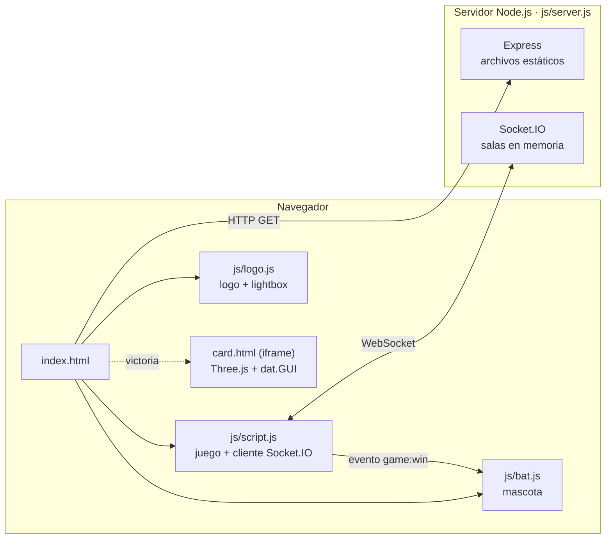
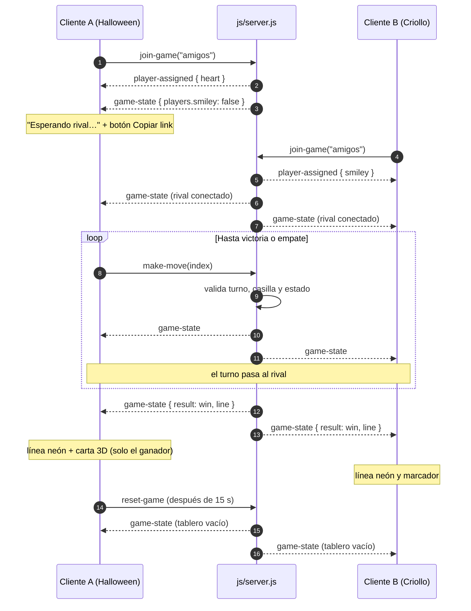
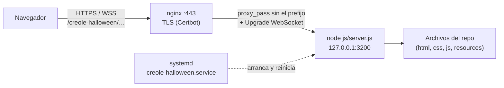

# Halloween Criollo🎃 
[](https://www.linkedin.com/in/drphp/)
[](https://www.linkedin.com/in/drphp/)

[](https://www.youtube.com/watch?v=62yWyHRWk0s)  
[](https://www.youtube.com/watch?v=62yWyHRWk0s)

## Resumen

Landing interactiva de Halloween con un Tres en Raya **Halloween 🎃 vs. Criollo 🎸** en tiempo real. El frontend es HTML, CSS y JavaScript vanilla, sin framework ni build. El backend es un servidor Express + Socket.IO que mantiene las salas y es la única fuente de verdad de la partida.

## 🚀 Quick Start

### Requisitos

- Node.js 18 o superior y npm.
- Navegador moderno. La carta 3D de recompensa necesita WebGL.

### Instalación y ejecución

```bash
git clone https://github.com/phpeitor/creole-halloween.git
cd creole-halloween
npm install
npm start
```

La aplicación queda en `http://localhost:3000`.

Para usar otro puerto:

```bash
PORT=4000 npm start          # Linux / macOS
$env:PORT=4000; npm start    # PowerShell
set PORT=4000 && npm start   # CMD
```

> No abras `index.html` con `file://`: sin el servidor no hay Socket.IO y el juego cae a modo local.

## Funcionalidades

**Juego**
- Tres en Raya con detección de las 8 líneas, empates y reinicio automático.
- Marcador por sesión, vista previa de la ficha al pasar el mouse y línea neón sobre la jugada ganadora.
- Modo local de respaldo cuando Socket.IO no está disponible.

**Multijugador**
- Salas aisladas con `?room=<id>`. Sin parámetro se usa `halloween`.
- Roles automáticos: el primer cliente es Halloween, el segundo Criollo y el resto espectadores.
- Validación autoritativa en el servidor: turno, casilla, jugador y estado de la partida.
- Estado de la sala ("Esperando rival…" / "Rival conectado") y botón para copiar el link de la sala.

**Experiencia**
- Video de fondo aleatorio (4 clips) sin repetir el de la visita anterior.
- Intro breve con máscara de calabaza; se salta con clic o tecla.
- Logo phpeitor animado en WebM con transparencia y lightbox.
- Murciélago mascota que vuela por los laterales sin tapar el tablero y celebra cada victoria.
- Carta 3D (Three.js + `dat.GUI`) como recompensa exclusiva del ganador durante 15 s.
- Sonido arcade opcional generado con Web Audio, apagado por defecto.

## Arquitectura



### Flujo de una partida multijugador



### Protocolo Socket.IO

| Dirección | Evento | Payload | Descripción |
| --- | --- | --- | --- |
| cliente → servidor | `join-game` | `roomId` | Entra a la sala (máx. 32 caracteres). |
| cliente → servidor | `make-move` | `index` (0–8) | Solicita una jugada; el servidor la valida. |
| cliente → servidor | `reset-game` | — | Reinicia el tablero si la partida terminó. |
| servidor → cliente | `player-assigned` | `{ player, roomId }` | Rol asignado: `heart`, `smiley` o `spectator`. |
| servidor → sala | `game-state` | `{ board, currentPlayer, scores, gameOver, players, result? }` | Estado completo; `result` indica victoria (`line`) o empate. |

El cliente nunca aplica una jugada por su cuenta en multijugador: solo pinta el `game-state` que emite el servidor.

### Eventos y estado del frontend

- `game:win` (`document`, `detail.player`): lo emite `highlightWin()`. Lo consumen componentes decorativos como la mascota, sin acoplarse al juego.
- `localStorage`:
  - `halloween-last-video`: último video mostrado.
  - `halloween-sound`: preferencia de sonido (`on`/`off`).

## Estructura del proyecto

```text
creole-halloween/
├── index.html            Shell de la landing, tablero y modal de recompensa
├── card.html             Escena 3D (demo y contenido del iframe)
├── css/
│   ├── styles.css        Layout arcade, tablero, intro, sala y modal
│   ├── logo.css          Componente de logo (imagen o video)
│   ├── batman.css        Sprite y estados de la mascota
│   └── card.css          Estilos de la carta 3D
├── js/
│   ├── server.js         Express + Socket.IO (backend)
│   ├── script.js         Juego, cliente Socket.IO, sonido y video
│   ├── logo.js           Interacción del logo y lightbox
│   ├── bat.js            Vuelo de la mascota
│   └── card.js           Three.js y controles dat.GUI
├── resources/            Videos, logo (PNG/WebM/WebP) y SVG de la intro
└── .ia-context/          Reglas y roles para asistentes de desarrollo
```

## Componente de logo reutilizable

No depende del tablero, de Socket.IO ni del servidor. Basta con incluir `css/logo.css` y `js/logo.js`:

```html
<!-- Imagen -->
<div class="logo" role="button" tabindex="0" aria-label="Abrir logo">
  <div class="box"></div>
</div>

<!-- Video con transparencia -->
<div class="logo logo--video" role="button" tabindex="0" aria-label="Abrir logo">
  <div class="box">
    <video src="./ruta/logo.webm" poster="./ruta/logo.webp" autoplay loop muted playsinline aria-hidden="true"></video>
  </div>
</div>
```

Admite clic, `Enter`, `Espacio` y `Escape`. Con `prefers-reduced-motion` se pausa. En Safari muestra el `poster`, porque no renderiza la transparencia de WebM.

## Accesibilidad y rendimiento

- Casillas como `<button>` con `aria-label`. Turno anunciado en `#game-status` (`role="status"`, `aria-live="polite"`).
- Foco visible en casillas, logo y botones. El modal de recompensa se cierra con `×`, `Escape`, clic fuera o de forma automática.
- `prefers-reduced-motion` desactiva la intro animada, el vuelo de la mascota, la animación del logo y los efectos de victoria.
- Se descarga un solo video de fondo por visita, y se pausa cuando la pestaña está oculta.

## Producción (nginx + systemd)

Ejemplo real: publicar el juego en `https://ubuntux.metadatape.com/creole-halloween/`, una subruta de un sitio que ya sirve nginx.



Las rutas del cliente son relativas: `./socket.io/socket.io.js`, y `io({ path })` se calcula a partir de la URL de la página. Por eso el mismo código funciona en la raíz (`/`) y en una subruta, sin configuración extra.

### 1. Servicio systemd

`/etc/systemd/system/creole-halloween.service`:

```ini
[Unit]
Description=Halloween Criollo (Express + Socket.IO)
After=network.target

[Service]
User=www-data
WorkingDirectory=/var/www/ubuntux/creole-halloween
Environment=NODE_ENV=production
Environment=HOST=127.0.0.1
Environment=PORT=3200
ExecStart=/usr/bin/node js/server.js
Restart=always
RestartSec=3

[Install]
WantedBy=multi-user.target
```

```bash
cd /var/www/ubuntux/creole-halloween && npm ci --omit=dev
sudo systemctl daemon-reload
sudo systemctl enable --now creole-halloween
systemctl status creole-halloween
```

### 2. nginx

Dentro del bloque `server { … listen 443 ssl; … }` del sitio:

```nginx
# Sin barra final las rutas relativas se resolverían contra la raíz del sitio
location = /creole-halloween {
    return 301 /creole-halloween/;
}

location /creole-halloween/ {
    proxy_pass http://127.0.0.1:3200/;          # la barra final quita el prefijo
    proxy_http_version 1.1;
    proxy_set_header Upgrade $http_upgrade;     # WebSocket
    proxy_set_header Connection "upgrade";
    proxy_set_header Host $host;
    proxy_set_header X-Real-IP $remote_addr;
    proxy_set_header X-Forwarded-For $proxy_add_x_forwarded_for;
    proxy_set_header X-Forwarded-Proto $scheme;
    proxy_read_timeout 1h;                      # conexiones de juego largas
}
```

```bash
sudo nginx -t && sudo systemctl reload nginx
```

Se usa un `location` de prefijo normal, sin `^~`. Así siguen aplicando antes las reglas regex del sitio, como las que bloquean `.md`, dotfiles o `.lock`.

### 3. Verificación

```bash
curl -I https://ubuntux.metadatape.com/creole-halloween                         # 301 a la barra final
curl -I https://ubuntux.metadatape.com/creole-halloween/                        # 200
curl -s "https://ubuntux.metadatape.com/creole-halloween/socket.io/?EIO=4&transport=polling"   # 0{"sid":…}
journalctl -u creole-halloween -f                                               # logs
```

Abre `https://ubuntux.metadatape.com/creole-halloween/?room=prueba` en dos navegadores. El primero muestra "Esperando rival…" y, al entrar el segundo, ambos pasan a "Rival conectado".

### Actualizar a una nueva versión

```bash
cd /var/www/ubuntux/creole-halloween
git pull
npm ci --omit=dev
sudo systemctl restart creole-halloween   # reiniciar borra las partidas en curso
```

## Desarrollo

| Comando | Uso |
| --- | --- |
| `npm install` | Instala Express y Socket.IO. |
| `npm start` | Inicia `js/server.js` (puerto 3000 o `PORT`; `HOST` opcional). |
| `node --check js/server.js` | Valida la sintaxis del servidor. |
| `node --check js/script.js` | Valida la sintaxis del cliente. |

Antes de modificar código, revisa las reglas de `.ia-context/` (`FRONTEND_RULES.md` y `AGENTS_ROLES.md`).

### Verificación manual

1. `npm install` y `npm start`.
2. Abrir la misma sala en dos navegadores: cada uno recibe un rol distinto y el primero ve "Esperando rival…" hasta que entra el segundo.
3. Alternar jugadas y comprobar la sincronización, la vista previa y que el rival no pueda jugar fuera de turno.
4. Ganar una partida: línea neón en ambos clientes y carta 3D solo en el ganador. Cierre manual, con `Escape` y automático a los 15 s.
5. Forzar un empate y comprobar el marcador.
6. Probar en móvil y con `prefers-reduced-motion`.
7. Revisar la consola y la pestaña de red: sin errores JavaScript ni respuestas 404.

## Limitaciones conocidas

- Las salas viven en memoria: reiniciar el proceso borra las partidas. Escalar a varias instancias requiere un adaptador compartido (por ejemplo Redis) y sticky sessions.
- `express.static` publica la raíz del proyecto, incluidos `js/server.js` y `package.json`. No contienen secretos, pero no se deben agregar credenciales al repositorio.
- La carta 3D carga Three.js y `dat.GUI` desde CDN.
- `node_modules/` está excluido en `.gitignore`.
